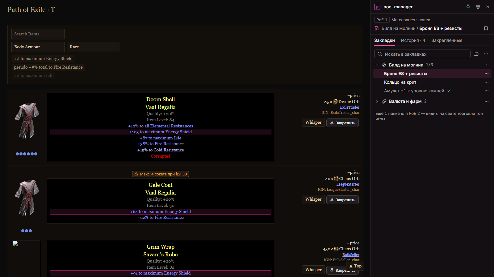

# poe-manager — расширение для pathofexile.com/trade

Боковая панель на сайте торговли Path of Exile (PoE 1 и PoE 2): закладки поисков по папкам, история,
закреплённые лоты и подсказки прямо в результатах поиска. Работает само по себе, а если запущено приложение
poe-manager — связывается с ним (Native Messaging). Интерфейс сделан на
дизайн-системе десктопного приложения poe-manager (React + Tailwind v4 + Radix + Lucide, токены «Фуксия»).

По функциям — замена Better PathOfExile Trading (разбор: [../docs/research-better-trading.md](../docs/research-better-trading.md)),
с переносом закладок в обе стороны.



## Установка (разработческая сборка)

```bash
pnpm install
pnpm build          # tsc + сборка в dist/
```

Chrome → `chrome://extensions` → включить «Режим разработчика» → «Загрузить распакованное расширение» → папка `dist/`.
Открыть https://www.pathofexile.com/trade — панель появится справа. Кнопка расширения на панели браузера
сворачивает и разворачивает её.

Перенос из Better Trading: там «Backup tools → Save file», здесь «Настройки → Восстановить из файла».
Отдельные папки переносятся кодом («Экспорт…» / «Импорт папки по коду…»), формат кода общий.

`pnpm package` — то же плюс архив для Chrome Web Store в `release/`.

## Что умеет

| Функция | Где | Отличие от Better Trading |
|---|---|---|
| Закладки: папки, значки, перетаскивание, архив, «выполнено», live-поиск, копирование ссылки | Панель → Закладки | Поиск по закладкам; значки — Lucide, а не арт игры |
| Сохранить открытый поиск, заменить закладку текущим поиском | Шапка панели, меню закладки | Имя подставляется из формы поиска |
| История последних 50 поисков | Панель → История | Имя дописывается, когда форма поиска заполнится; «В закладки» в один клик |
| Закреплённые лоты | Кнопка «Закрепить» у лота → Панель → Закреплённые | **Сохраняются** между перезагрузками; показаны компонентами дизайн-системы (редкость, моды, порча, цена), «Показать в результатах» |
| Подсветка модов из фильтров поиска | В строке лота | — |
| Предупреждение «Макс. N сокетов при iLvl …» (PoE 1, нагрудники) | В строке лота | — |
| Группировка одинаковых лотов одного продавца | В строке лота | — |
| Заголовок вкладки: имя закладки, ⚡ для live, счётчик новых лотов сайта | Вкладка браузера | — |
| Выключение каждого улучшения | Настройки | Применяется сразу, без перезагрузки |
| Резервная копия закладок в файл | Настройки | Формат совместим с BT; повторное восстановление не дублирует папки |
| Связь с приложением poe-manager | Значок в шапке панели, Настройки | Нет у BT. Этап 1: рукопожатие и статус с обеих сторон |

Пересчёта цен нет: цены будут в приложении (решение 18 в `docs/architecture.md`).

## Как устроено

```
вкладка pathofexile.com/trade
├─ page-hook.js     мир страницы: оборачивает history.pushState → событие «переход»
├─ content.js       изолированный мир: раскладка, iframe панели, навигация, история,
│                   заголовок вкладки, улучшения результатов, закрепление лотов
├─ content.css      токены дизайн-системы на .pmgr-ui + стили элементов в странице
└─ <iframe panel.html>  панель: React + дизайн-система целиком
        ▲ postMessage (состояние страницы ↔ команды панели)
background.js       service worker: связь с приложением (Native Messaging), кнопка расширения
chrome.storage.local  закладки, история, закреплённые, настройки — общие для панели и страницы
```

- **Панель — iframe со страницей расширения.** Стили сайта и наши не влияют друг на друга, а дизайн-система
  работает без доработок: порталы Radix (меню, диалоги, подсказки), шрифты, Tailwind. Сайт не перекрывается:
  он сужается на ширину панели (400 px), как у Better Trading.
- **Элементы в результатах** (цены, кнопки, плашки) — обычный DOM без React. Цвета и размеры — те же токены,
  но объявлены на классе `.pmgr-ui`, а не на `:root`: глобальная область чужого сайта не трогается.
  Префикс `pmgr-` — потому что у сайта есть свой класс `pm-btn` (личные сообщения).
- **Навигация** отслеживается событиями (хук pushState + popstate), опрос раз в секунду — только подстраховка.
- **Данные** не пересылаются сообщениями: панель и страница читают `chrome.storage.local` и слушают `onChanged`.
- **Права:** `storage` и `nativeMessaging`. Расширение никуда не ходит по сети.

| Папка | Что там |
|---|---|
| `src/shared/` | Модели и логика без DOM: адреса торговли, закладки, история, экспорт/импорт/бэкап, хранилище, сообщения и протокол связи |
| `src/content/` | Content script: раскладка, навигация, разбор строк результатов, улучшения, заголовок вкладки |
| `src/panel/` | Панель на React: шапка, Закладки, История, Закреплённые, Настройки, диалоги |
| `src/background/` | Service worker: связь с приложением (`bridge.ts`) |
| `src/design-system/` | **Копия** дизайн-системы десктопа (см. ниже) |
| `dev/` | Макет сайта торговли, заглушка `chrome.*`, скрипт скриншотов |
| `scripts/` | Сборка, синхронизация дизайн-системы, проверка токенов, генерация иконок |

## Связь с приложением poe-manager

Протокол и решения — `../docs/extension-bridge.md`. Коротко:

- Service worker держит соединение Native Messaging (хост `com.poemanager.bridge`), пока открыта хотя бы одна
  вкладка торговли. Хост — сам `poe-manager.exe` в режиме моста; его регистрирует в Chrome приложение при запуске.
- Приложение расширение **не запускает**: пока оно закрыто, статус «Приложение не запущено», связь появится сама.
- Статус — в `chrome.storage.session`: значок в шапке панели (зелёный — на связи) и раздел в настройках.
- **ID расширения постоянный** — `abnbkbopbfhbfbinmeihjniikcamacol`: `scripts/build.mjs` пишет в манифест поле `key`
  из `scripts/extension-id.json`. Его же ждёт приложение. В архив для магазина (`pnpm package`) `key` не попадает —
  ID из Chrome Web Store нужно будет добавить приложению (`POE_MANAGER_EXTENSION_IDS`).

Проверить вживую: собрать и загрузить `dist/`, запустить приложение (`pnpm tauri dev` в `desktop-application`),
открыть pathofexile.com/trade. В строке статусов приложения — «Расширение подключено», в панели — зелёный значок.
Ошибки соединения — в консоли service worker (`chrome://extensions` → «service worker»), лог моста —
`%LOCALAPPDATA%\com.poemanager.desktop\logs\bridge.log`.

## Дизайн-система

Источник истины — `desktop-application/ui/src/design-system`. Расширение — отдельный репозиторий,
поэтому держит копию: руками в `src/design-system/` не править.

```bash
pnpm sync:design-system   # скопировать из ../desktop-application (или DESKTOP_DIR=…)
```

Скрипт копирует папку без тестов, пишет `src/design-system/SOURCE.md` (дата, хэш) и генерирует
`src/content/generated/tokens-scoped.css` — токены для элементов внутри страницы сайта.

Правила те же, что в десктопе (`docs/design/guide.md`): только токены (`pnpm check:tokens`), игровые цвета —
только по смыслу и с текстом, акцент — только для интерактива, статусы — с иконкой, компактная плотность.
Иконки расширения (`public/icons`) — временная монограмма, как `AppLogo`; генерирует `scripts/make-icons.py`.

## Разработка

```bash
pnpm dev                  # Vite; макет сайта: http://localhost:5173/dev/trade-mock.html?seed=1
pnpm check                # tsc + check:tokens + тесты (Vitest)
node dev/screenshots.mjs  # скриншоты макета в .screens/ (нужен pnpm dev и Chrome; PORT=…, CHROME=…)
```

Макет `dev/trade-mock.html` повторяет только скелет разметки сайта, на который опираются селекторы
(`src/content/search-panel.ts`, `src/content/row-parser.ts`), и подставляет заглушку `chrome.*` на localStorage.
Параметры: `?seed=1` — примеры закладок и истории, `?reset=1` — первый запуск, `&path=/trade/search/…` — другой поиск.

## Ограничения и что дальше

- **Селекторы сайта проверены по Better Trading 1.9.2 и макету, но не на живом сайте** (в этой среде нет доступа
  через Cloudflare). Если сайт поменяет вёрстку, править `search-panel.ts` и `row-parser.ts`; отказ одного
  улучшения не ломает остальные (ошибки ловятся и пишутся в консоль).
- Разметка предмета для закреплённых лотов (`itemPopupContainer`, `*Mod`, `unmet`) — стандартная разметка подсказки
  pathofexile.com; тиры и prefix/suffix сайт в строке не показывает, поэтому в карточке их нет.
- Связь с приложением — пока только этап 1 (рукопожатие и статус). Синхронизация закладок и действия между
  приложением и браузером — следующие этапы `docs/extension-bridge.md`.
- Интерфейс только на русском, как и десктоп (i18n не подключён).
- Firefox не проверялся: нужен `browser_specific_settings` и замена `world: "MAIN"` (есть с Firefox 128).
